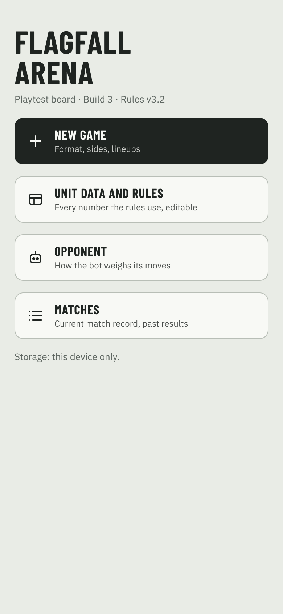
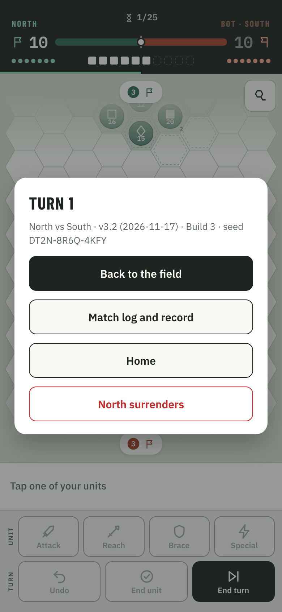
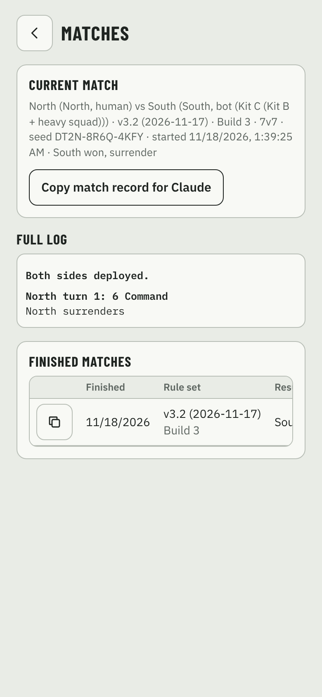

# Brief 003 — Version line on the board

| | |
|---|---|
| Rule set | none (no rule changes) |
| Date | 17 Nov 2026 |
| Goal | The Editor can always see which build and rule set he is playing, every saved match records its build, and every pull request comes with a link to play it. |
| Branch | `build/003-version-line` |
| Flags | none |

## Context
Today nothing on the board says which version of the code is running. When the Editor reports a problem, or a match is analysed later, there is no way to tie it to a build. The Process Lessons agreed a version line: the rule set plus a build number that goes up with every accepted change. This build adds it.

This brief branch already sits on top of Brief 002's build. **Start only after Brief 002 is merged**, then update this branch from `main` first. It also adds a play link to every pull request, so the Editor can try a build before merging it without the design chat publishing a copy by hand.

## Scope
In: a build number kept in one place, shown on three screens and stored with each match; a check that it went up; a play link for `main` and for every pull request. Out: any rule, bot or layout change beyond the lines below.

## What to build
1. **One source for the build number.** A new file `board/version.js` holding the build number and its date, loaded by `index.html` before `app.js`. Numbering: brief 001 was build 1, brief 002 build 2, so this build is **build 3**. The board's code must not invent or compute the number anywhere else.
2. **Home screen.** Replace the line under the title, "Playtest board", with: `Playtest board · Build 3 · Rules v3.2`. The rule set shown is the newest preset (the new-game default), named by its id. Same font, size and colour as the line it replaces.
3. **In-match menu** (the "Turn N" box). After the rule set name in its first line, add ` · Build 3`. The rule set shown there stays the match's own rule set, which can be older than the newest.
4. **Saved matches.** Every new match records the build number it was started on (for example `build: 3`). Show it in the match record on the Matches screen beside the rule set (`· Build 3`). A match saved before this build has no build number: show nothing for it, never a guess. Old matches must still load and replay.
4b. **Copy any finished match.** Today only the current match has "Copy match record for Claude"; finished matches in the Matches table can't be copied at all. Add a Copy button on each finished match's row (an icon button is fine on phone), copying the same record format as the current-match button.
5. **Every build raises the number.** Add a check to the `checks` workflow: on a pull request, the build number in `board/version.js` must be higher than on `main`. A pull request that changes nothing in `board/` may keep it the same. Add one line to `CLAUDE.md` under Process: every build that changes `board/` raises the build number by one in `board/version.js` and puts it in its `CHANGELOG.md` heading.
6. **CHANGELOG.md.** This build's entry is headed `Build 3`. Give the earlier entries their numbers too (Brief 001 = Build 1, Brief 002 = Build 2).

7. **Play links (free GitHub Pages).** A workflow publishes the board so it can be played in a browser:
   - `main` at `https://productofdefiance.github.io/Flagfall/` on every push to `main`;
   - each open pull request at `https://productofdefiance.github.io/Flagfall/pr/<number>/`, updated on every push to it and removed when it closes.
   Publish from a `gh-pages` branch the workflow maintains (only the `board/` files, not tests). The workflow appends `Play this build: <link>` as the last line of the pull request description, replacing any earlier one. Note in the board's Home line which build a preview is, so previews can't be mistaken for `main` (for example `Build 3 · Preview of PR #6`).
8. **Fast checks on every pull request, full checks at night.** Brief 002's double-knockout count made every pull request's checks take about 45 minutes. Split `checks` in two:
   - **Quick (every pull request and push, target under 10 minutes):** all the rule tests, the replay of Match 3, the regression hashes, `test_invariants.js`, the v3 red team run, and a short double-knockout count (40 games per format) so a broken rule still fails fast.
   - **Full (every night at about 3 AM New York time, plus a "Run workflow" button the Editor can press):** the full 400 + 400 double-knockout count and anything else slow. A failing night run opens a `FLAGS.md`-style note as a GitHub issue titled "Night checks failed", so it can't go unseen.
   Keep the `checks` name on the quick run, so the protection rule on `main` keeps working. A pull request that changes `board/engine.js`, `board/data.js`, `board/bot.js` or `board/brain.js` may also be given the label `full checks` to run the full set before merging. Put the button's location in the Report.
9. **One-time setting for the Editor.** After the workflow has run once, the Editor turns Pages on: Settings → Pages → Source: *Deploy from a branch* → `gh-pages` / root → Save. Put these exact clicks in the Report's to-dos.

## Rules it touches
None. Storing the build number with a match must not change what the engine replays.

## Bot minimum
n/a: nothing the bot can do changes.

## Must not change
Every preset plays and replays identically (`regress_engine.js` hashes unchanged for every rule set). The engine is untouched. Matches saved before this build still open and replay.

## Checks before opening the pull request
- Every check in `README.md`.
- Open a match saved by the current board (before this build) and confirm it loads, replays and shows no build number.
- The pull request's own play link opens and plays.
- Prove the new workflow check can fail: on a throwaway branch, change something in `board/` without raising the number and confirm `checks` goes red. Say in the Report that you did this.

## The Editor's hands-on check
Open the pull request's play link: Home shows `Build 3 · Rules v3.2` and that it's a preview. Start a match, open the menu: it shows `Build 3`. Finish or abandon it, open Matches: the record shows `Build 3`, and its Copy button works.

## Report back
The standard Report, plus screenshots (phone width) of the three places the build number now appears.

---

## Report
*Filled in by Claude Code.*

- **What's in:**
  - `board/version.js`: build 3, its date, and a `preview` field (null on `main`). It's the only place the number is kept, and `index.html` loads it before `app.js`.
  - **Home:** "Playtest board · Build 3 · Rules v3.2", in the same style as before. The rule set is the newest preset's id. A preview copy reads "Playtest board · Build 3 · Preview of PR #5 · Rules v3.2".
  - **In-match menu:** "· Build 3" after the match's own rule set name. If the match was started on a different build, it adds "(started on Build N)". A match with no recorded build gets no guess.
  - **Saved matches:** new matches store `build: 3` at the top of the match record (outside the engine's options, so replays are unaffected). The finished match's summary carries it too. The Matches screen shows it under the rule set, and on the current-match card. Old matches show none.
  - **Copy any finished match:** a copy-icon button on every finished match's row, copying the same record format as the current-match button (which now also includes `build`). The result is worked out by replaying the moves.
  - **Build number check:** in `checks`, `.github/check-build-number.sh` fails a pull request whose `board/` differs from the base but whose build number isn't higher. An earlier board with no `version.js` counts as 0. CLAUDE.md has the new Process line.
  - **Quick and full checks:** `checks` is now four parallel jobs plus a final `checks` job, the one `main`'s protection rule requires. It always runs and fails unless all four passed; a skipped required check would count as passed, so it can't be skipped. On this pull request the quick set took **3 minutes** (was 26–45). `test_v32.js` runs there with 40 games per format. `night-checks` runs the full 400 + 400 count and 100 impossible-state games nightly at 08:07 UTC. It can also be started by hand, or by the `full checks` label (created by this build). A failing night or by-hand run opens, or comments on, a "Night checks failed" issue.
  - **Play links:** `play-links` publishes `board/` (without `tests/`) to the `gh-pages` branch: `main` at the root, each open pull request under `pr/<number>/`, marked as a preview, and removed when it closes. It then writes "Play this build: <link>" as the last line of the description.
  - CHANGELOG entries are numbered Build 1–3. The README lists the play links and how the checks are split.
- **Anything beyond the brief, and why:**
  1. **The build sits on its own line under the rule set on the Matches screen,** not beside it. At phone width the table is wider than the screen, and "· Build 3" beside the rule set was cut off. See the screenshot below.
  2. **The in-match menu shows the running build,** with "(started on Build N)" when the match began on another one. The brief didn't say which build to show, and this way a bug report names the code actually running.
  3. **`checks` now also runs on pull requests into branches other than `main`.** I needed that to prove the build-number check fails, by comparing against a branch that already has build 3; `main` has no build number yet. It's also handy for any future stacked pull requests.
  4. **`test_invariants.js` fix (F21).** Brief 002's test treated "a living unit shows HP 0" as impossible. The first 100-game run caught it twice: a flag holder whose pool was down to its last half point. That's v3.1's display rounding working as designed, so the test now allows exactly that case, and I raised the display question as F21. Before the fix, 100 games gave 10 problems (all this case); after it, 0.
  5. **Device-only storage didn't keep a finished match's moves** before this build (only a summary). The board now also keeps each finished match's full record on the device, so Copy works from Build 3 on.
- **Checks run and results (paste regression hashes):**
  - Locally (Node.js 22): test_rules pass; test_v1 12/0; test_v3 10/0; test_v31 22/0; test_v32 rule checks 57/0; test_rng 7/0; replay of Match 3: 386 checks, 0 mismatches; test_invariants 100 games: 0 problems after the F21 fix.
  - `checks` on this pull request (Node.js 20): green in 3 minutes, all four jobs passed.
  - `night-checks` on this pull request, through the `full checks` label: test_v32 full count passed (0 double knockouts in 400 + 400 games, in 19 minutes). test_invariants with 100 games failed on F21, before the fix above. It reruns on this pull request with the fix.
  - Regression hashes, from `checks` on this pull request, `main` (`70106b2`) vs this build, all identical: match3 `37397ef2bd3ed86b`, v1 `7b25bca651c0cb31`, v2 `ddbe5fc437ff4e9d`, v3 `26371927b53d4413`, v3.1 `c71e4cd12fc984b0`. v3.2 is the newest preset, so it isn't hashed. The engine, rule data, bot and brain files are unchanged.
  - **Proof the build-number check can fail:** throwaway branch `throwaway/003-build-number-red` added one comment line to `board/skin.js` and left the build at 3. Its pull request into this branch ([productofdefiance/Flagfall#6](https://github.com/productofdefiance/Flagfall/pull/6)) went red on "build number and replay hashes" alone ("FAIL: raise the build number in board/version.js (it must be higher than 3)"); every other job passed. I closed that pull request.
  - **An old saved match still works:** I made a match in the old format on the board from `main` (no build field), one unfinished and one finished. On this build the unfinished one shows "Continue match", opens and replays to turn 3. Its finished row shows no build number. Its Copy button says the moves weren't kept, because it's a device-only match from before Build 3.
  - **The play link:** this sandbox can't reach github.io, so I fetched the exact files `play-links` published for this pull request (`gh-pages`, `pr/5/`). Played locally, Home shows "Build 3 · Preview of PR #5 · Rules v3.2", and a full match works: start, menu shows Build 3, surrender, the Matches row shows Build 3, and Copy gives a record with `build: 3`. The live link needs Pages switched on (to-do 1).
  - Skipped, per CLAUDE.md: the v3.2 baseline. No rule or bot change.
- **Baseline table (rule changes only):** n/a
- **Bot minimum (met / not met, with numbers):** n/a. Nothing the bot can do changed.
- **Screenshots (phone width):**

  | Home | In-match menu | Matches |
  |---|---|---|
  |  |  |  |
- **Your to-dos:**
  1. Switch GitHub Pages on: **Settings → Pages → Source: Deploy from a branch → `gh-pages` / root → Save.** Wait a minute or two, then open the play link at the end of this pull request.
  2. The full checks button: **Actions tab → night-checks (left list) → Run workflow → Run workflow.** It appears once this pull request is merged.
  3. Delete the throwaway branch: open [productofdefiance/Flagfall#6](https://github.com/productofdefiance/Flagfall/pull/6) and click **Delete branch**. This session can't delete branches.
- **Known gaps:**
  1. Device-only matches finished before Build 3 can't be copied, because their moves were never kept. The button says so instead of failing silently.
  2. GitHub schedules in UTC only, so the night run is at 3:07 AM New York time in winter and 4:07 AM in summer.
  3. `main`'s own play link appears only after this pull request is merged, the first push to `main` with the workflow.
  4. Each push to a pull request with the `full checks` label reruns the full set (about 25 minutes). Remove the label once it has passed.
- **Flags closed / opened:** Opened F21 (ASK). None closed.
- **Pull request:** https://github.com/productofdefiance/Flagfall/pull/5
